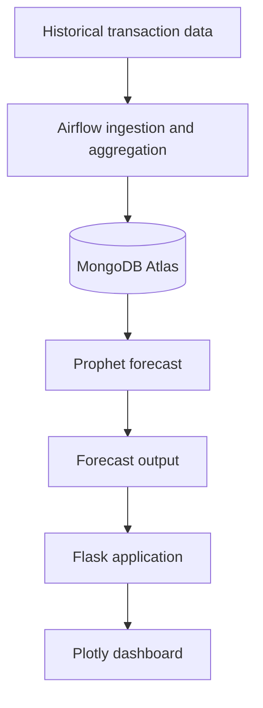

# E-Commerce Sales Forecasting Pipeline

A collaborative data pipeline project for preparing historical online retail transactions, generating a 30-day revenue forecast and presenting the output through a Flask and Plotly dashboard.

The project combines Apache Airflow, Python, Prophet, MongoDB Atlas and Docker. Contributions are listed by area in the authors section.

## Architecture



## Components

| Layer | Technology | Responsibility |
|---|---|---|
| Orchestration | Apache Airflow | Schedule and coordinate data tasks |
| Storage | MongoDB Atlas | Store transaction and aggregated data |
| Forecasting | Prophet | Generate a 30-day forecast from daily revenue |
| Dashboard | Flask, Plotly | Present forecast data and interactive charts |
| Local environment | Docker Compose | Run the application services |

## Pipeline flow

1. Ingest historical transaction data.
2. Prepare and aggregate daily revenue.
3. Fit the forecasting model and generate a 30-day horizon.
4. Persist or export forecast output.
5. Render the forecast and available filters in the dashboard.

## Local setup

### Prerequisites

- Docker and Docker Compose
- Python version compatible with the project dependencies
- A MongoDB connection string for a database you control

### Clone

```bash
git clone https://github.com/sunkaradp/ecommerce-sales-forecasting-pipeline.git
cd ecommerce-sales-forecasting-pipeline
```

### Configure environment

Create a local `.env` file. Do not commit it.

```dotenv
MONGO_URI=<your-mongodb-connection-string>
```

Provide the same value through the deployment platform's encrypted environment-variable settings. The repository's Render Blueprint declares `MONGO_URI` as a value that must be configured outside source control.

### Start services

```bash
docker compose up --build
```

The original project configuration documents the Airflow UI at `http://localhost:8080` and the dashboard at `http://localhost:5000`. Confirm the ports against the current Compose configuration before use.

## Forecast output

The documented forecast uses Prophet with a 30-day horizon. The expected output fields are:

- `ds`: forecast date
- `yhat`: point forecast
- `yhat_lower`: lower uncertainty bound
- `yhat_upper`: upper uncertainty bound

No model accuracy or throughput figures are stated here because reproducible evaluation results are not included in this README.

## Contributions

- Harsha Vijaya Kumar — Airflow DAGs, project documentation and deployment
- Saikiran Magadi Lakshmeesha — ETL pipelines and Flask dashboard
- Durgaprasad Sunkara — Docker orchestration and MongoDB integration
- Supreetha Devagiri — Prophet modeling and hyperparameter tuning

## Security note

Credentials must be supplied through local environment files or the deployment platform's secret configuration. If a credential has ever been committed, changing the current file is not sufficient: rotate the credential at the provider and review repository history and deployment logs.

## License

[MIT License](https://mit-license.org/)
